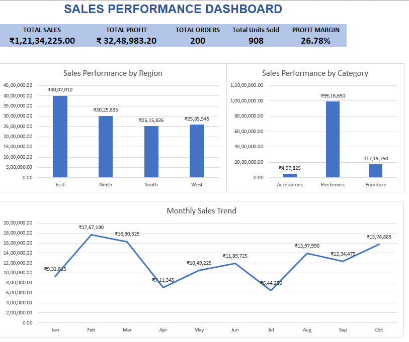
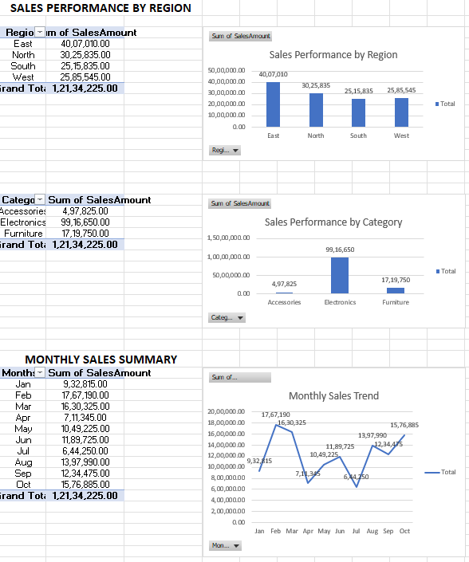
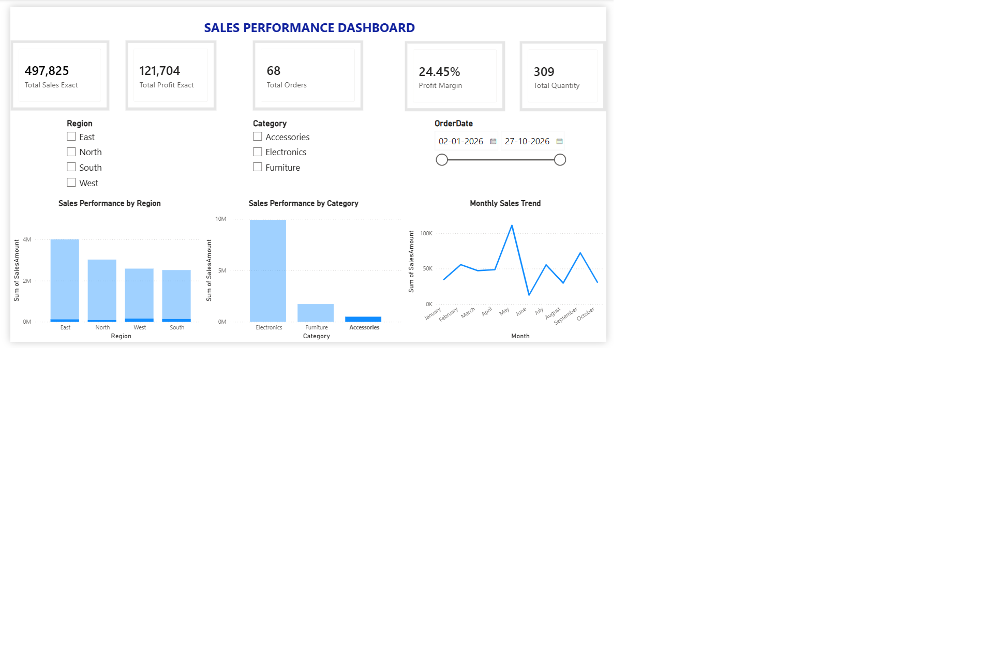

# Sales Performance Analysis Portfolio

# Project 1: Excel Sales Performance Analysis

## Project Overview
This is a personal Data Analytics project developed using Microsoft Excel.

The project analyses 200 sales records to understand business performance, revenue, profitability, regional sales, product-category performance, and monthly sales trends.

## Dashboard Preview



## Pivot Analysis



## Project Objectives
- Analyse overall sales and profit.
- Compare sales performance across regions.
- Identify sales contributions by product category.
- Understand monthly sales trends.
- Calculate important business KPIs.
- Create a dashboard to present business insights.

## Tools and Features Used
- Microsoft Excel
- Excel Tables and Filters
- Excel Formulas and Functions
- Data Validation
- PivotTables
- PivotCharts
- KPI Reporting
- Dashboard Design

## Project Workflow
1. Imported and organised the sales dataset.
2. Formatted the raw data and created a working copy.
3. Calculated sales values and validated them against the original sales amounts.
4. Created a KPI summary.
5. Analysed sales by region, category, and month using PivotTables.
6. Created PivotCharts to visualise the results.
7. Built a Sales Performance Dashboard.

## Key Performance Indicators

The dashboard highlights five key measures: total sales, total profit, total orders, total units sold, and profit margin.

| KPI | Result |
|---|---:|
| Total Sales | ₹1,21,34,225.00 |
| Total Profit | ₹32,48,983.20 |
| Total Orders | 200 |
| Total Units Sold | 908 |
| Profit Margin | 26.78% |

## Key Findings
- East was the highest-performing region by sales.
- Electronics contributed approximately 81.7% of total sales.
- February recorded the highest monthly sales.
- July recorded the lowest monthly sales.
- All 200 calculated sales records matched the original sales amounts.

## Data Validation
Calculated sales were compared with the original SalesAmount values.

- Matching records: 200
- Mismatched records: 0

## Workbook Structure
| Worksheet | Description |
|---|---|
| Dashboard | Visual summary of sales performance |
| KPI_Summary | Key business performance indicators |
| Pivot_Analysis | Sales analysis using PivotTables and PivotCharts |
| Cleaned_Data | Calculated sales and validation results |
| Raw_Data | Original sales dataset |

## Project Files
- `Ravikiran_Sales_Performance_Analysis.xlsx` – Completed Excel analysis project.
- `Sales_Performance_Practice.xlsx` – Original practice workbook.

## Project Outcome
Developed an Excel-based sales analysis solution using formulas, data validation, PivotTables, PivotCharts, and a dashboard to summarise business performance and identify key sales trends.

**Project Type:** Personal Practice Project  
**Tool:** Microsoft Excel

---

# Project 2: Power BI Sales Performance Dashboard

## Project Overview

This project focuses on analyzing sales performance using Microsoft Power BI.

The interactive dashboard provides insights into total sales, total profit, total orders, profit margin, product quantity, regional performance, category performance, and monthly sales trends.

The project uses the same sales dataset as Project 1, containing 200 sales records, to demonstrate data cleaning, data analysis, DAX calculations, and interactive dashboard development.

## Project Objectives

- Analyze overall sales and profit performance.
- Calculate important business KPIs.
- Compare sales performance across different regions.
- Analyze sales performance by product category.
- Identify monthly sales trends.
- Build an interactive dashboard using Power BI.
- Support data-driven business decisions through visual reporting.

## Tools Used

- **Microsoft Power BI Desktop** – Dashboard development and data visualization.
- **Power Query** – Data cleaning and preparation.
- **DAX** – KPI calculations and measures.
- **Microsoft Excel** – Initial data analysis and validation.
- **GitHub** – Project documentation and portfolio hosting.

 ## Dataset Details

The dataset contains 200 sales records with the following columns:

- OrderID
- OrderDate
- Region
- SalesRep
- Customer
- Product
- Category
- Quantity
- UnitPrice
- DiscountPct
- SalesAmount
- CostAmount
- Profit

The dataset was sourced from the Excel sales performance project and imported into Power BI for further analysis.

## Data Cleaning and Preparation

Data preparation was performed using Power Query in Power BI.

The following steps were completed:

- Imported the Cleaned_Data sheet from the Excel workbook.
- Removed the unnecessary Total Mismatch helper column.
- Assigned appropriate data types to each column.
- Checked important fields for blank or missing values.
- Verified that OrderID contains 200 unique order IDs.
- Applied the changes and loaded the cleaned data into Power BI.

 ## DAX Measures

The following DAX measures were created to calculate key business performance indicators.

**1. Total Sales**
```DAX
Total Sales = SUM('Cleaned_Data'[SalesAmount])
```

**2. Total Profit**
```DAX
Total Profit = SUM('Cleaned_Data'[Profit])
```

**3. Profit Margin**
```DAX
Profit Margin = DIVIDE([Total Profit], [Total Sales], 0)
```

**4. Total Quantity**
```DAX
Total Quantity = SUM('Cleaned_Data'[Quantity])
```

Additional display measures were created to show sales and profit values in full-number format.

These measures were used to build the dashboard KPI cards.

## Dashboard Features

The Power BI dashboard includes five KPI cards that provide a quick summary of business performance:

- **Total Sales:** ₹1,21,34,225
- **Total Profit:** ₹32,48,983
- **Total Orders:** 200
- **Profit Margin:** 26.78%
- **Total Quantity:** 908

### Dashboard Visualizations



Three charts were developed:

1. **Sales Performance by Region** – Compares sales across East, West, North, and South.
2. **Sales Performance by Category** – Compares sales across Electronics, Furniture, and Accessories.
3. **Monthly Sales Trend** – Displays monthly sales performance from January to October 2026.

### Interactive Slicers

Three slicers were added:

- Region
- Category
- Order Date

The slicers allow users to filter the report by region, product category, and order date. The KPI cards and charts update to reflect the selected filters.

## Key Findings

- Total sales across 200 orders amounted to ₹1,21,34,225.
- Total profit was ₹32,48,983.
- Overall profit margin was 26.78%.
- East was the highest-performing region, with sales of ₹40,07,010.
- Electronics was the highest-performing category, with sales of ₹99,16,650.
- Monthly sales performance was analyzed from January to October 2026.

## Data Validation

The Power BI dashboard results were compared with the Excel Pivot_Analysis sheet.

The following results were successfully validated:

- All 10 monthly sales totals matched.
- All 4 regional sales totals matched.
- All 3 category sales totals matched.

This validation confirmed that the Power BI analysis was consistent with the Excel project.

## Project Files

- [Download Excel Analysis Workbook](Ravikiran_Sales_Performance_Analysis.xlsx)
- [Download Power BI Dashboard](Ravikiran_Sales_Performance_Dashboard.pbix)
